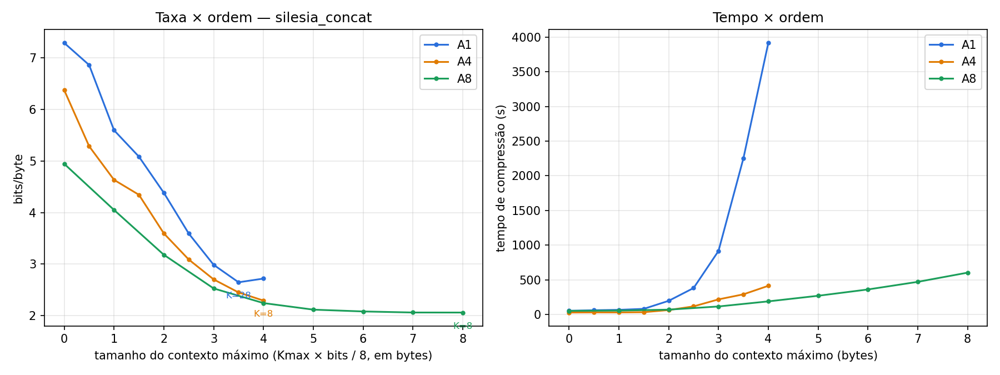
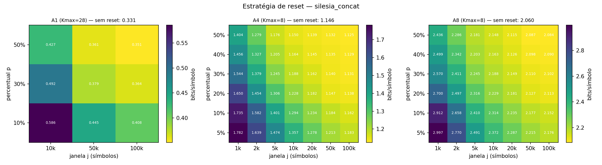
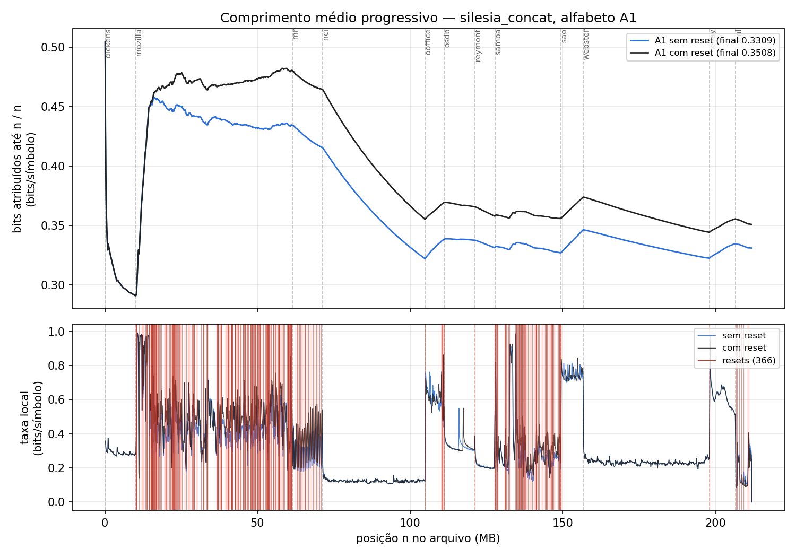

# Relatório — Compressor PPM-C com exclusão e reset (ITI 2026.2)

**Emmanuel Aprígio Cavalcanti dos Santos** e **Kaio César de Oliveira Barreto** · Introdução à Teoria da Informação — 2026.2

## 1. Introdução

Este trabalho implementa em C++ um compressor sem perdas baseado no PPM-C com exclusão. Ele é avaliado em três resoluções de alfabeto (1, 4 e 8 bits) sobre o Corpus Silesia. O foco é a velocidade de aprendizado do modelo e sua reação quando a distribuição da fonte muda.

### 1.1 Contextualização

Todo compressor estatístico tem duas partes. O **modelo** estima a probabilidade de cada símbolo dado o que já foi visto. O **codificador** transforma essas probabilidades em bits. Um bom modelo atribui probabilidade alta ao que de fato acontece, e o codificador aritmético converte isso em um comprimento muito próximo do mínimo teórico.

Arquivos reais raramente são fontes estacionárias. O Corpus Silesia reúne 12 arquivos de natureza muito diferente: texto em inglês e em polonês, executáveis, bancos de dados, imagens médicas, XML. Quando o compressor passa de um arquivo para outro, as estatísticas aprendidas deixam de valer. Por isso o trabalho também implementa uma estratégia de reset do modelo, disparada pela piora da taxa local.

### 1.2 Fundamentação teórica

**Informação e entropia.** Um símbolo x com probabilidade p(x) carrega informação própria I(x). Para uma fonte sem memória, a entropia H é a média dessa informação, e o comprimento médio L de qualquer código unicamente decodificável satisfaz L ≥ H.

$$
I(x) = -\log_2 p(x) \qquad H(X) = -\sum_{x} p(x)\log_2 p(x) \qquad L \ge H(X)
$$

Com memória, o limite passa a ser a entropia condicional ao passado. É ela que um modelo de contexto tenta aproximar.

**Codificação aritmética.** A mensagem inteira é representada por um subintervalo de [0, 1). Cada símbolo reduz o intervalo proporcionalmente à sua probabilidade, e o número de bits necessário para identificar o intervalo final é aproximadamente a soma de −log2 p(xᵢ). Usamos a versão inteira de Witten, Neal e Cleary (1987), com renormalizações E1, E2 e E3.

**PPM (Prediction by Partial Matching).** Proposto por Cleary e Witten (1984), o PPM estima a probabilidade do próximo símbolo a partir dos k símbolos anteriores, o contexto de ordem k. A codificação começa na maior ordem disponível, Kmax. Se o símbolo nunca apareceu naquele contexto, emite-se um **escape** e tenta-se a ordem k−1. Na ordem −1, todos os símbolos são equiprováveis.

**Método C.** A variante C (Moffat, 1990) estima o escape pelo número de símbolos distintos d já vistos no contexto, dentre n ocorrências:

$$
P(s) = \frac{c(s)}{n + d} \qquad P(\text{escape}) = \frac{d}{n + d}
$$

**Exclusão.** Ao escapar de um contexto, sabe-se que o símbolo não é nenhum dos que lá aparecem. Esses símbolos são retirados da contagem nas ordens inferiores, e a probabilidade que ocupariam é redistribuída. Isso reduz o custo dos escapes sem perda de informação.

### 1.3 Objetivos

- Implementar compressor e descompressor PPM-C com exclusão para os alfabetos A1 = {0,1}, A4 = {0..15} e A8 = {0..255}.
- Implementar o monitoramento da taxa local em janelas de j símbolos, com reset do modelo quando a piora passa de p%, mantendo o descompressor sincronizado.
- Medir comprimento médio, tempos de compressão e descompressão em função de Kmax, j e p, e comparar com compressores de uso geral.
- Analisar a curva de comprimento médio progressivo no texto de Dickens e no Silesia completo.
- Demonstrar a integridade da descompressão com cmp.

## 2. Materiais e métodos

O compressor foi escrito em C++17, sem bibliotecas externas, e compilado com `g++ -O2`. Os scripts de experimentos e gráficos usam Python 3 com matplotlib. O código está em [github.com/kaiocesarb15/PPM-C](https://github.com/kaiocesarb15/PPM-C).

### 2.1 Organização do código

| Arquivo | Responsabilidade |
| --- | --- |
| `BitIO.hpp` | escrita e leitura de bits individuais |
| `SymbolStream.hpp` | conversão de bytes em símbolos de 1, 4 ou 8 bits e vice-versa |
| `ArithmeticCoder.hpp` | codificador e decodificador aritmético inteiro de 32 bits |
| `PPMModel.hpp` | modelo PPM-C: contextos, escape, exclusão, atualização |
| `RateMonitor.hpp` | janelas de j símbolos, regra de p% e decisão de reset |
| `Compressor.hpp` | cabeçalho do arquivo e laço principal de compressão e descompressão |
| `main.cpp` | linha de comando e medição de tempo |

### 2.2 Alfabetos

O mesmo arquivo é lido em três resoluções. Em A8 cada byte é um símbolo; em A4 cada byte gera dois símbolos (nibble alto, depois baixo); em A1 cada byte gera oito símbolos (bit mais significativo primeiro). Um arquivo de N bytes tem 8N/b símbolos no alfabeto de b bits.

Como o número de símbolos muda com o alfabeto, os resultados são dados em **bits/símbolo**, como pede o enunciado, e também em **bits/byte** do arquivo original. Só a segunda medida permite comparar os alfabetos entre si e com os compressores comerciais. Pelo mesmo motivo, Kmax = 32 em A1, Kmax = 8 em A4 e Kmax = 4 em A8 enxergam o mesmo passado: 4 bytes.

### 2.3 Modelo PPM-C

Cada ordem k tem uma tabela hash (`std::unordered_map`). A chave é o contexto empacotado num inteiro de 64 bits, que comporta todos os casos do trabalho: A1 com k = 32 ocupa 32 bits e A8 com k = 8 ocupa 64. Cada contexto guarda uma lista esparsa de pares (símbolo, contagem), o que evita alocar 256 contadores por contexto em A8.

Para cada símbolo, o modelo desce de min(Kmax, símbolos já vistos) até 0:

1. Calcula n e d apenas com os símbolos não excluídos do contexto. Contextos vazios são pulados sem custo.
2. Se o símbolo está no contexto, codifica-o com probabilidade c(s)/(n+d) e para.
3. Caso contrário, codifica o escape com probabilidade d/(n+d) e exclui os símbolos daquele contexto.
4. Se nenhuma ordem contém o símbolo, usa a ordem −1, uniforme sobre os símbolos ainda não excluídos.

Três detalhes completam o modelo:

- **Escape impossível.** Quando o contexto já contém todos os símbolos ainda possíveis, não se reserva probabilidade para o escape: P(s) = c(s)/n. Isso pesa sobretudo em A1, cujos contextos ficam completos com apenas dois símbolos.
- **Atualização.** Incrementa-se a contagem no contexto onde o símbolo foi achado e nos de ordem maior visitados antes dele (exclusão de atualização, como no PPMC original).
- **Rescale.** Quando a soma das contagens de um contexto passa de 65.000, todas são divididas por 2. Isso evita estouro dos contadores de 16 bits.

### 2.4 Reset por taxa local

A sequência é dividida em janelas adjacentes de j símbolos. Ao fechar cada janela, compara-se o número de bits gastos nela (B_atual) com o da janela anterior (B_ant). Como as duas têm o mesmo tamanho, comparar os bits equivale a comparar os comprimentos médios:

$$
\text{reset} \iff B_{\text{atual}} \cdot 100 > B_{\text{ant}} \cdot (100 + p)
$$

O reset apaga todas as tabelas. O histórico dos últimos símbolos é mantido, pois apenas identifica o contexto corrente. A janela seguinte a um reset não é comparada; ela vira a nova referência. Sem essa regra, o modelo ainda reaprendendo dispararia resets em cascata.

**Sincronia com o descompressor.** O custo de cada símbolo é medido pelo número de renormalizações do codificador aritmético. Cada renormalização corresponde a exatamente um bit de saída. O decodificador executa as mesmas renormalizações nos mesmos símbolos. Assim, os dois lados medem os mesmos valores inteiros e decidem o reset no mesmo ponto, sem nenhuma marca extra no arquivo.

### 2.5 Limite de memória

Modelos de ordem alta crescem sem limite: A8 com Kmax = 8 usou 557 MB só no dickens (10 MB). O programa estima a memória das tabelas (112 bytes por contexto mais 4 bytes por símbolo registrado) e reinicia o modelo quando a estimativa passa do limite configurado, 2 GB por padrão. A estimativa foi calibrada: com limite de 400 MB, o pico medido foi 386 MB. A decisão é determinística e, portanto, também sincronizada. Esses resets são contados à parte dos resets por taxa. Nos experimentos finais, o limite foi de 4 GB por execução.

### 2.6 Formato do arquivo

Um cabeçalho de 32 bytes guarda o identificador, o alfabeto, Kmax, j, p, o limite de memória e o tamanho original. Com isso, o descompressor recebe apenas o arquivo comprimido. O cabeçalho está incluído em todas as taxas reportadas.

### 2.7 Dados e protocolo experimental

O Corpus Silesia (211.938.580 bytes, 12 arquivos) foi concatenado em ordem alfabética num único arquivo, para que as mudanças de fonte apareçam como transições entre arquivos. A análise de aprendizado usa também o arquivo `dickens` (10.192.446 bytes, obras de Charles Dickens) isolado. Uma amostra de 24 MB (os primeiros 2 MB de cada arquivo) serviu apenas para testes preliminares; seus resultados estão em `resultados/preliminar_vm/`.

1. **Ordem.** Kmax de 0 a 8 em A4 e A8, e de 0 a 32 em A1, sem reset. No dickens, o A1 foi testado em todos os valores de 0 a 32. No Silesia completo, por causa do tempo, foi testado de 4 em 4 (0, 4, …, 32). Cada execução comprime, descomprime e compara byte a byte com o original.
2. **Reset.** Com o melhor Kmax de cada alfabeto no Silesia, foram testados j ∈ {1.000, 2.000, 5.000, 10.000, 20.000, 50.000, 100.000} e p ∈ {5, 10, 20, 30, 40, 50}% em A4 e A8 (42 combinações cada). Em A1, o alfabeto mais lento, foram testados j ∈ {10.000, 50.000, 100.000} e p ∈ {10, 30, 50}% (9 combinações). Nesta etapa mediu-se só a compressão.
3. **Comerciais.** gzip -9, bzip2 -9, xz -9, zstd -19, 7-Zip LZMA2 -mx9 e 7-Zip PPMd -mx9, nos mesmos arquivos, verificados com `cmp`.
4. **Curvas.** Comprimento médio progressivo, isto é, bits acumulados até a posição n divididos por n, amostrado em cerca de 2.000 pontos. Para cada alfabeto, com o melhor Kmax, sem reset e com o melhor j e p.

Todos os experimentos foram executados pelo script `scripts/rodar_tudo.sh`, num computador com processador AMD Ryzen 7 5700G (8 núcleos físicos, 16 lógicos, 3,8 GHz) e 40 GB de RAM, com Windows 11 e Ubuntu no WSL2 (34 GB visíveis). Rodaram 6 execuções do PPM-C em paralelo, com limite de memória de 4 GB cada. Os tempos medem apenas a compressão ou a descompressão em memória (`std::chrono::steady_clock`), sem leitura e gravação em disco. Os compressores comerciais rodaram sozinhos, sem outras execuções em paralelo, então seus tempos são um pouco favorecidos na comparação.

## 3. Resultados

No Silesia completo, o melhor PPM-C foi o **A8 com Kmax = 8: 2,060 bits/byte**, praticamente empatado com o bzip2 (2,061) e atrás de zstd, xz e 7-Zip. No texto de Dickens, o A8 com Kmax = 6 atinge **1,90 bits/byte** e só perde para o PPMd do 7-Zip. Com o critério proposto, o reset melhorou apenas o A4 (−1,9%); no A8 e no A1, nenhuma combinação de j e p superou o modelo sem reset.

### 3.1 Análise de ordem e desempenho

A tabela traz os resultados sem reset. A coluna "Contexto" converte Kmax em bytes de passado (Kmax × b / 8), para comparar os alfabetos na mesma base. No dickens, o A1 aparece de 4 em 4 para coincidir com o Silesia; a varredura completa está em `resultados/ordem_dickens.csv`. Em negrito, o melhor Kmax de cada alfabeto em cada arquivo. Todas as 78 execuções foram descomprimidas idênticas ao original.

| Alfabeto | Kmax | Contexto (bytes) | dickens bits/byte | dickens t. comp. (s) | dickens t. desc. (s) | Silesia bits/símb. | Silesia bits/byte | Silesia t. comp. (s) | Silesia t. desc. (s) | Resets por memória (Silesia) |
| --- | --- | --- | --- | --- | --- | --- | --- | --- | --- | --- |
| A8 | 0 | 0 | 4,5225 | 1,4 | 1,1 | 4,9442 | 4,9442 | 53 | 47 | 0 |
| A8 | 1 | 1 | 3,4897 | 1,1 | 1,1 | 4,0497 | 4,0497 | 57 | 50 | 0 |
| A8 | 2 | 2 | 2,8075 | 1,0 | 1,0 | 3,1803 | 3,1803 | 70 | 63 | 0 |
| A8 | 3 | 3 | 2,2669 | 1,2 | 1,2 | 2,5277 | 2,5277 | 116 | 110 | 0 |
| A8 | 4 | 4 | 1,9960 | 2,3 | 2,4 | 2,2437 | 2,2437 | 189 | 192 | 0 |
| A8 | 5 | 5 | 1,9068 | 4,6 | 4,7 | 2,1165 | 2,1165 | 270 | 259 | 1 |
| A8 | 6 | 6 | **1,9015** | 6,6 | 7,0 | 2,0814 | 2,0814 | 361 | 388 | 2 |
| A8 | 7 | 7 | 1,9341 | 9,6 | 9,3 | 2,0610 | 2,0610 | 471 | 491 | 4 |
| A8 | 8 | 8 | 1,9811 | 13,5 | 12,2 | 2,0603 | **2,0603** | 603 | 619 | 6 |
| A4 | 0 | 0 | 6,7640 | 1,4 | 1,1 | 3,1867 | 6,3734 | 29 | 22 | 0 |
| A4 | 1 | 0,5 | 4,8610 | 1,4 | 1,2 | 2,6429 | 5,2857 | 31 | 26 | 0 |
| A4 | 2 | 1 | 3,7793 | 1,3 | 1,1 | 2,3168 | 4,6335 | 30 | 26 | 0 |
| A4 | 3 | 1,5 | 3,3244 | 1,4 | 1,2 | 2,1719 | 4,3437 | 33 | 30 | 0 |
| A4 | 4 | 2 | 2,8902 | 1,6 | 1,4 | 1,7973 | 3,5946 | 65 | 52 | 0 |
| A4 | 5 | 2,5 | 2,6271 | 2,0 | 1,8 | 1,5442 | 3,0884 | 117 | 107 | 0 |
| A4 | 6 | 3 | 2,3336 | 2,4 | 2,4 | 1,3517 | 2,7033 | 218 | 210 | 0 |
| A4 | 7 | 3,5 | 2,1901 | 4,3 | 3,8 | 1,2249 | 2,4498 | 291 | 291 | 1 |
| A4 | 8 | 4 | **2,0554** | 4,6 | 6,5 | 1,1460 | **2,2920** | 414 | 411 | 2 |
| A1 | 0 | 0 | 7,9284 | 2,8 | 2,4 | 0,9111 | 7,2888 | 54 | 49 | 0 |
| A1 | 4 | 0,5 | 7,4577 | 3,3 | 2,9 | 0,8576 | 6,8609 | 62 | 56 | 0 |
| A1 | 8 | 1 | 5,2583 | 3,4 | 3,2 | 0,6994 | 5,5954 | 67 | 63 | 0 |
| A1 | 12 | 1,5 | 3,7755 | 3,6 | 3,5 | 0,6354 | 5,0834 | 82 | 80 | 0 |
| A1 | 16 | 2 | 3,1419 | 5,4 | 6,2 | 0,5478 | 4,3820 | 197 | 203 | 0 |
| A1 | 20 | 2,5 | 2,7389 | 12,8 | 12,9 | 0,4490 | 3,5919 | 382 | 457 | 0 |
| A1 | 24 | 3 | 2,4662 | 24,0 | 27,5 | 0,3732 | 2,9853 | 916 | 1100 | 0 |
| A1 | 28 | 3,5 | 2,3255 | 31,7 | 40,4 | 0,3309 | **2,6471** | 2251 | 2008 | 22 |
| A1 | 32 | 4 | **2,2386** | 44,9 | 58,9 | 0,3399 | 2,7188 | 3915 | 3200 | 49 |

Principais observações:

- **O Kmax ótimo depende da fonte.** No texto de Dickens, o A8 tem um ótimo claro em K = 6; acima disso, os contextos ficam raros demais e os escapes em cascata pioram a taxa. No Silesia, a taxa continua caindo até K = 8, mas com ganho cada vez menor: de K = 6 para K = 8, só 0,021 bits/byte (1%), enquanto o tempo de compressão sobe de 361 s para 603 s.
- **Com o mesmo passado de 4 bytes**, o alfabeto maior sempre comprime melhor: no dickens, A8 (K = 4) faz 2,00 bits/byte, A4 (K = 8) faz 2,06 e A1 (K = 32) faz 2,24. No Silesia, 2,24, 2,29 e 2,72.
- **No A1, o limite de memória define o ótimo.** No Silesia, K = 28 foi melhor que K = 32 (2,65 contra 2,72 bits/byte). Com K = 32, o modelo atingiu o limite de 4 GB 49 vezes e foi reiniciado; com K = 28, 22 vezes. No dickens, que é pequeno, o limite nunca foi atingido, e K = 32 foi o melhor.
- **O custo cresce muito com a ordem, sobretudo no A1.** Comprimir o Silesia levou 54 s com A1 e K = 0, e 65 minutos com K = 32. O A8 com K = 8 levou 10 minutos, e o A4 com K = 8, 7 minutos. A descompressão leva aproximadamente o mesmo tempo que a compressão, porque o descompressor refaz todo o trabalho do modelo.



Figura 1 — Taxa (bits/byte) e tempo de compressão em função do contexto máximo em bytes (Kmax × b / 8), Silesia completo. O gráfico equivalente para o dickens está em `resultados/grafico_ordem_dickens.png`.

### 3.2 Estratégia de reset

Com o critério de reset por taxa local, a taxa melhora de forma monotônica à medida que j e p aumentam. Em todos os alfabetos, a melhor combinação foi a do canto da grade: **j = 100.000 e p = 50%**, a que reseta menos.

| Alfabeto | Kmax | Sem reset (bits/byte) | Melhor com reset (bits/byte) | Melhor j | Melhor p | Resets | Variação | Combinações melhores que sem reset |
| --- | --- | --- | --- | --- | --- | --- | --- | --- |
| A8 | 8 | **2,0603** | 2,0844 | 100.000 | 50% | 72 | +1,2% | 0 de 42 |
| A4 | 8 | 2,2920 | **2,2495** | 100.000 | 50% | 96 | −1,9% | 9 de 42 |
| A1 | 28 | **2,6471** | 2,8062 | 100.000 | 50% | 366 | +6,0% | 0 de 9 |

No A4, as 9 combinações que superaram o modelo sem reset são j = 100.000 com p ≥ 20%, j = 50.000 com p ≥ 30% e j = 20.000 com p ≥ 40%. No outro extremo, janelas pequenas transformam o critério em ruído. No A8, j = 1.000 com p = 5% disparou 43.523 resets e piorou a taxa para 3,00 bits/byte (+45%). No A4, a mesma configuração chegou a 92.357 resets. O CSV completo está em `resultados/reset_silesia_concat.csv`.



Figura 2 — Bits/símbolo em função de j e p no Silesia completo, um painel por alfabeto, com a taxa sem reset no título. Cores mais claras indicam taxas menores.

As três melhores configurações com reset foram depois comprimidas e descomprimidas no Silesia completo e comparadas com `cmp`. As três resultaram em arquivos idênticos ao original, com exatamente as mesmas taxas da grade. Nessa verificação rodaram só 3 execuções em paralelo, por isso os tempos são um pouco menores que os da grade. A saída completa está em `resultados/verificacao_reset.txt`.

| Alfabeto | Kmax | j | p | bits/byte | t. comp. (s) | t. desc. (s) | `cmp` |
| --- | --- | --- | --- | --- | --- | --- | --- |
| A8 | 8 | 100.000 | 50% | 2,0844 | 414 | 401 | idêntico |
| A4 | 8 | 100.000 | 50% | 2,2495 | 275 | 283 | idêntico |
| A1 | 28 | 100.000 | 50% | 2,8062 | 1931 | 1893 | idêntico |

### 3.3 Comparação com compressores comerciais

| Compressor | dickens (bits/byte) | dickens t. comp. (s) | dickens t. desc. (s) | Silesia (bits/byte) | Silesia t. comp. (s) | Silesia t. desc. (s) |
| --- | --- | --- | --- | --- | --- | --- |
| 7-Zip PPMd -mx9 | **1,790** | 3,5 | 2,9 | **1,814** | 31,8 | 34,6 |
| 7-Zip LZMA2 -mx9 | 2,222 | 4,0 | 0,1 | 1,838 | 55,0 | 1,6 |
| xz -9 (LZMA2) | 2,222 | 7,1 | 0,1 | 1,840 | 84,7 | 1,5 |
| zstd -19 | 2,237 | 6,7 | 0,03 | 1,995 | 40,5 | 0,3 |
| **PPM-C A8** (K = 6 no dickens, K = 8 no Silesia) | 1,902 | 6,6 | 7,0 | 2,060 | 603 | 619 |
| bzip2 -9 | 2,197 | 0,6 | 0,3 | 2,061 | 11,9 | 5,1 |
| PPM-C A4, K = 8 (no Silesia, com reset) | 2,055 | 4,6 | 6,5 | 2,250 | 275 | 283 |
| gzip -9 | 3,023 | 0,7 | 0,04 | 2,554 | 14,0 | 0,6 |
| PPM-C A1 (K = 32 no dickens, K = 28 no Silesia) | 2,239 | 44,9 | 58,9 | 2,647 | 2251 | 2008 |

No texto de Dickens, o PPM-C A8 supera bzip2, xz, 7-Zip LZMA2 e zstd, e só perde para o PPMd. No Silesia, com muitos dados binários, o PPM-C A8 empata com o bzip2 e fica atrás dos compressores LZ modernos.

O PPMd é uma evolução do PPM com estimação adaptativa do escape (SEE) e herança de contagens entre ordens. A diferença de 0,11 bits/byte no dickens e de 0,25 no Silesia mostra o quanto o método C deixa na mesa. Nos dados binários, os compressores LZ exploram repetições longas, a distâncias de muitos megabytes, que um contexto fixo de até 8 bytes não alcança. Em velocidade, o PPM-C é de 7 a 50 vezes mais lento que os comerciais no Silesia. Isso se deve em parte à implementação didática, com tabelas hash genéricas da biblioteca padrão.

### 3.4 Aprendizado e estacionariedade no dickens

No texto de Dickens, A4 e A8 chegam a 10% do valor final em menos de 1 MB. A1 precisa de 3,4 MB. Depois disso, as três curvas caem devagar até o fim do arquivo: o modelo continua aprendendo contextos mais raros.

| Posição no arquivo | A1, K = 32 (bits/byte) | A4, K = 8 (bits/byte) | A8, K = 6 (bits/byte) |
| --- | --- | --- | --- |
| 100 KB | 4,53 | 2,79 | 2,58 |
| 500 KB | 3,11 | 2,29 | 2,16 |
| 1 MB | 2,77 | 2,18 | 2,04 |
| 2 MB | 2,63 | 2,19 | 2,05 |
| 5 MB | 2,37 | 2,10 | 1,96 |
| 10 MB (final) | 2,24 | 2,06 | 1,90 |

| Critério de estabilização | A1 | A4 | A8 |
| --- | --- | --- | --- |
| dentro de ±10% do valor final | 3,38 MB | 0,57 MB | 0,70 MB |
| dentro de ±5% do valor final | 5,46 MB | 2,81 MB | 3,48 MB |
| dentro de ±1% do valor final | 8,87 MB | 7,25 MB | 8,09 MB |

O ponto de estabilização é a primeira posição a partir da qual a média progressiva nunca mais se afasta do valor final mais que a tolerância. Com ±10%, o "joelho" da curva fica em torno de 0,6 a 0,7 MB para A4 e A8, e de 3,4 MB para A1.

A1 aprende muito mais devagar. Com 100 KB lidos, A8 já faz 2,58 bits/byte e A1 ainda faz 4,53. Prever um caractere em A1 exige oito decisões binárias, cada uma com seu próprio contexto, e cada contexto precisa ser visto várias vezes antes de ficar confiável. A4 começa pior que A8 (2,79 contra 2,58 em 100 KB), mas os contextos de A4 são menos numerosos e se preenchem mais rápido. Por isso A4 entra na faixa de ±10% antes de A8.

Perto de 1 MB, as três curvas têm uma pequena subida. É o único ponto visível de não-estacionariedade dentro do dickens, provavelmente a passagem para outra obra com vocabulário diferente.


Figura 3 — Comprimento médio progressivo no dickens, em bits/byte, para A1 (K = 32), A4 (K = 8) e A8 (K = 6). Os gráficos individuais em bits/símbolo, com os pontos de estabilização marcados, estão em `resultados/grafico_curva_dickens_a{1,4,8}.png`.

### 3.5 Aprendizado e estacionariedade no Silesia

No Silesia completo, a taxa local salta a cada troca de arquivo, e a média progressiva nunca estabiliza: ela sobe nos arquivos difíceis e desce nos fáceis. A tabela decompõe a taxa por arquivo, calculada pela diferença de bits acumulados entre as fronteiras de cada arquivo na curva progressiva. As colunas "com reset" usam j = 100.000 e p = 50%.

| Arquivo | Tipo | MB | A8 sem | A8 com | A4 sem | A4 com | A1 sem | A1 com | Resets (A8 / A4 / A1) |
| --- | --- | --- | --- | --- | --- | --- | --- | --- | --- |
| dickens | texto em inglês | 10,2 | 1,974 | 1,974 | 2,048 | 2,048 | 2,308 | 2,308 | 0 / 0 / 0 |
| mozilla | executáveis e bibliotecas (tar) | 51,2 | **2,792** | 2,868 | 3,101 | 3,095 | **3,702** | 4,145 | 37 / 63 / 247 |
| mr | imagem de ressonância magnética | 10,0 | **2,135** | 2,270 | **1,983** | 2,122 | **2,379** | 2,914 | 10 / 8 / 21 |
| nci | base de estruturas químicas | 33,6 | 0,566 | 0,570 | 0,742 | 0,740 | 0,982 | 0,978 | 1 / 1 / 0 |
| ooffice | DLL do OpenOffice | 6,2 | 3,726 | **3,623** | 4,103 | **3,900** | 4,938 | **4,869** | 3 / 2 / 8 |
| osdb | banco de dados de teste | 10,1 | 2,208 | **2,128** | 2,345 | **2,157** | 2,630 | 2,620 | 1 / 1 / 1 |
| reymont | texto em polonês (PDF) | 6,6 | 1,453 | 1,447 | 1,641 | **1,602** | 1,771 | **1,742** | 1 / 1 / 2 |
| samba | código-fonte (tar) | 21,6 | 1,749 | 1,748 | 2,165 | **2,009** | **2,395** | 2,741 | 13 / 14 / 78 |
| sao | catálogo de estrelas | 7,3 | 5,768 | **5,727** | 6,001 | **5,924** | 5,963 | 5,960 | 1 / 1 / 1 |
| webster | dicionário | 41,5 | **1,400** | 1,448 | 1,637 | 1,637 | 1,870 | 1,870 | 0 / 0 / 0 |
| x-ray | radiografia | 8,5 | 4,320 | **4,268** | 4,296 | **4,168** | 4,946 | **4,917** | 1 / 1 / 1 |
| xml | arquivos XML | 5,3 | 0,767 | 0,766 | 1,314 | **1,017** | 1,487 | **1,363** | 4 / 4 / 7 |

Valores em bits/byte. Em negrito, a melhor versão de cada alfabeto quando a diferença passa de 0,02 bits/byte.

**Onde a compressão sofre.** As maiores perdas ocorrem na entrada do `mozilla`, onde a taxa local salta de ~2 para ~8 bits/símbolo, e nas entradas de `ooffice`, `sao` e `x-ray`. Nesses pontos, o modelo traz contextos e contagens de um arquivo de natureza muito diferente. Os símbolos novos custam escapes em todas as ordens, e os antigos carregam probabilidades erradas.

**Onde o reset ajuda.** Nas entradas de ooffice, osdb, sao, x-ray e xml, o reset disparou no primeiro MB do novo arquivo. No A4, isso recuperou de 0,08 a 0,30 bits/byte nesses arquivos; no A8, de 0,04 a 0,10 (o xml quase não mudou). O maior ganho foi no xml em A4, de 1,31 para 1,02 bits/byte: o modelo herdado do x-ray era especialmente ruim para texto estruturado.

**Onde o reset atrapalha.** Os arquivos `mozilla`, `mr` e `samba` são internamente heterogêneos: um tar de binários variados, uma imagem com fatias de estatística diferente e um tar de código-fonte. Neles, a taxa local oscila mais de 50% entre janelas vizinhas, e o critério dispara resets que descartam modelos ainda úteis. No A8, foram 37 resets só no mozilla, que piorou 0,08 bits/byte; no A1, 247 resets no mozilla e 78 no samba, que pioraram 0,44 e 0,35 bits/byte. Como esses três arquivos somam 83 MB, 39% do corpus, as perdas neles superaram os ganhos nas transições no A8 e no A1. No A4, os ganhos foram maiores que as perdas.

**O limite de memória também age como reset.** Sem reset por taxa, o modelo foi reiniciado por memória 6 vezes no A8 (mozilla, ooffice, samba, sao e x-ray), 2 no A4 e 22 no A1. Ou seja, o modelo "sem reset" também esquece de tempos em tempos, justamente nos arquivos grandes e heterogêneos. Isso reduz a vantagem que o reset por taxa poderia ter. A piora do webster no A8 com reset (1,400 → 1,448) vem do único reset por memória dessa execução, que caiu no webster.


Figura 4 — Silesia completo, A8 com Kmax = 8. Em cima, comprimento médio progressivo com e sem reset (j = 100.000, p = 50%). Embaixo, taxa local entre pontos consecutivos da curva. Linhas tracejadas cinza marcam as fronteiras entre arquivos; linhas vermelhas, os resets.


Figura 5 — Silesia completo, A4 com Kmax = 8, com e sem reset.



Figura 6 — Silesia completo, A1 com Kmax = 28, com e sem reset.

### 3.6 Integridade

Todas as execuções com descompressão foram verificadas byte a byte e reproduziram o original: as 51 do dickens, as 27 do Silesia completo, as 3 melhores configurações com reset no Silesia completo (seção 3.2) e os 112 testes do `scripts/verificar.sh`. Esses testes cobrem arquivos vazio, de 1 byte, só zeros, aleatório, repetitivo, misto e código-fonte, em 16 configurações de alfabeto, Kmax, reset e limite de memória. Os resets também ficaram sincronizados: num caso extremo (A1, j = 1.000, p = 5%), compressor e descompressor registraram os mesmos 22.722 resets e o arquivo foi recuperado intacto.

```
$ ./ppmc c -a 8 -k 6 dados/dickens dickens.ppmc
bytes_entrada: 10192446
bytes_saida: 2422615
bits_por_byte: 1.901498
$ ./ppmc d dickens.ppmc dickens.out
bytes_saida: 10192446
$ cmp dados/dickens dickens.out && echo IDENTICOS
IDENTICOS
$ sha256sum dados/dickens dickens.out
b24c37886142e11d0ee687db6ab06f936207aa7f2ea1fd1d9a36763c7a507e6a  dados/dickens
b24c37886142e11d0ee687db6ab06f936207aa7f2ea1fd1d9a36763c7a507e6a  dickens.out
```

## 4. Discussão

### 4.1 Rapidez de aprendizado e cardinalidade do alfabeto

O alfabeto maior aprende mais rápido por byte lido. No dickens, A8 chega a 2,58 bits/byte nos primeiros 100 KB, A4 a 2,79 e A1 a 4,53. A1 precisa de cerca de 3,4 MB para ficar a 10% do seu valor final; A4 e A8, de menos de 1 MB.

A explicação está em quantas decisões o modelo precisa aprender para prever um caractere. Em A8 é uma decisão, num contexto que já inclui os bytes anteriores inteiros. Em A1 são oito decisões binárias em sequência, e as primeiras ainda não sabem nada sobre o byte atual. Cada uma dessas oito "posições de bit" tem seus próprios contextos, que precisam ser vistos várias vezes antes de darem boas previsões.

No fim, com o mesmo passado (4 bytes), os três alfabetos ficam próximos no texto: 2,00 (A8), 2,06 (A4) e 2,24 (A1) bits/byte. No Silesia, a distância é maior (2,24, 2,29 e 2,72), porque o A1 também esbarra no limite de memória.

### 4.2 Impacto dos parâmetros

**Kmax.** Aumentar Kmax ajuda até o ponto em que os contextos ficam raros demais para ter estatística. No texto, esse ponto é K = 6 no A8. Nos dados mistos do Silesia, o ganho continua até K = 8, mas é pequeno a partir de K = 6. O tempo e a memória crescem com Kmax em todos os casos, e muito mais rápido no A1: de K = 24 para K = 32, o tempo de compressão no Silesia passou de 15 para 65 minutos.

**j e p.** Janelas pequenas tornam o critério ruidoso. Com j = 1.000 e p = 5%, o A8 fez 43 mil resets e piorou 45%. A taxa melhora sempre que j ou p aumentam, e o melhor ficou no canto da faixa pedida (j = 100.000, p = 50%). Isso indica que, com esse critério, o melhor é resetar o mínimo possível. No A8 e no A1, o melhor de fato é não resetar. O valor de j também precisa ser pensado na unidade do alfabeto: 100.000 símbolos são 100 KB em A8, mas só 12,5 KB em A1. Por isso o A1 reseta mais, 366 vezes contra 72 no A8, e é o mais prejudicado.

### 4.3 Estratégias de tratamento de mudanças na distribuição

O reset por taxa local acerta as transições reais entre arquivos muito diferentes, como as entradas de ooffice, osdb, x-ray e xml, e recupera a taxa logo depois delas. O problema são os falsos positivos em arquivos internamente heterogêneos (`mozilla`, `mr`, `samba`), onde a taxa local oscila naturalmente mais que p entre duas janelas. O critério compara só duas janelas vizinhas e não distingue essa oscilação de uma mudança de fonte.

O reset total também é uma resposta drástica: joga fora até as estatísticas de ordem baixa, que costumam continuar úteis. O rescale de contagens (divisão por 2) e o limite de memória já dão ao modelo alguma capacidade de esquecer. Melhorias possíveis, não implementadas:

- exigir que a piora se mantenha por duas ou mais janelas seguidas antes de resetar;
- comparar a janela atual com a média de várias janelas anteriores, e não só com a última;
- exigir também uma piora mínima absoluta, em bits/símbolo, além da relativa;
- em vez de apagar tudo, dividir todas as contagens por um fator grande (reset "suave"), ou apagar só as ordens altas.

### 4.4 Problemas e dificuldades

- **Sincronia do reset.** Medir o custo em ponto flutuante (−log2 p) no compressor e no descompressor poderia gerar decisões diferentes em máquinas distintas. A solução foi contar as renormalizações do codificador aritmético, um valor inteiro e idêntico nos dois lados.
- **Memória.** A8 com Kmax = 8 usou 557 MB só no dickens. No Silesia completo, sem limite, os modelos de ordem alta precisariam de dezenas de GB. O limite determinístico resolveu, mas interfere nos resultados: no A1 com K = 32, o modelo foi reiniciado 49 vezes, e o "sem reset" também esquece de tempos em tempos.
- **Tempo.** A varredura completa levou cerca de 6 horas em 16 núcleos, com 6 execuções em paralelo. O A1 com Kmax alto custou até 65 minutos por compressão, quase sempre em inserções de contextos novos na tabela hash. Por isso, no Silesia, o A1 foi testado de 4 em 4 ordens e com uma grade de reset menor.
- **Escape em A1.** No PPM-C clássico, um contexto binário que já viu os dois símbolos continua reservando probabilidade para o escape, que nunca pode ocorrer. Detectar esse caso e não reservar a probabilidade foi importante para A1.

## 5. Conclusão

O compressor PPM-C com exclusão foi implementado para os três alfabetos e recupera os arquivos byte a byte em todos os testes. No texto, A8 com Kmax = 6 atinge 1,90 bits/byte, melhor que bzip2, xz e zstd. No Silesia completo, A8 com Kmax = 8 atinge 2,060 bits/byte, empatado com o bzip2.

A cardinalidade do alfabeto determina a velocidade de aprendizado. A8 e A4 ficam a 10% do valor final em menos de 1 MB de texto; A1 precisa de mais de três vezes isso e termina 12% pior no texto e 21% pior no Silesia, com o mesmo passado de 4 bytes. O A1 é também de 4 a 7 vezes mais lento que o A8.

O reset por taxa local, sincronizado sem nenhum bit extra pela contagem de renormalizações, detecta as trocas de arquivo e recupera a taxa logo depois delas. No corpus completo, porém, os falsos positivos dentro de arquivos heterogêneos custaram mais do que os acertos: o reset ajudou só o A4 (−1,9%) e, mesmo assim, com a configuração mais conservadora testada. Um critério mais robusto (piora persistente ou reset parcial) é o próximo passo natural.

## Referências

- CLEARY, J. G.; WITTEN, I. H. Data compression using adaptive coding and partial string matching. *IEEE Transactions on Communications*, v. 32, n. 4, p. 396–402, 1984.
- MOFFAT, A. Implementing the PPM data compression scheme. *IEEE Transactions on Communications*, v. 38, n. 11, p. 1917–1921, 1990.
- WITTEN, I. H.; NEAL, R. M.; CLEARY, J. G. Arithmetic coding for data compression. *Communications of the ACM*, v. 30, n. 6, p. 520–540, 1987.
- DEOROWICZ, S. Silesia compression corpus. Disponível em: [sun.aei.polsl.pl/~sdeor/index.php?page=silesia](https://sun.aei.polsl.pl/~sdeor/index.php?page=silesia).
- SAYOOD, K. *Introduction to Data Compression*. 5. ed. Morgan Kaufmann, 2017.
- Código-fonte do trabalho: [github.com/kaiocesarb15/PPM-C](https://github.com/kaiocesarb15/PPM-C).
