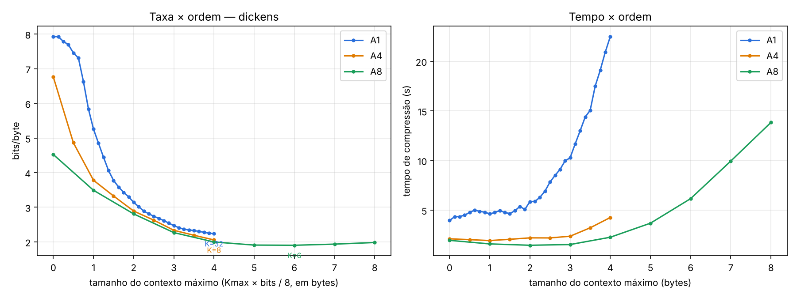
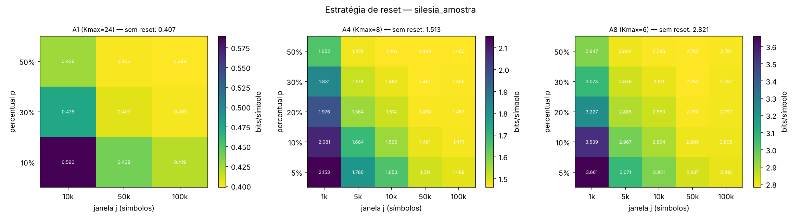
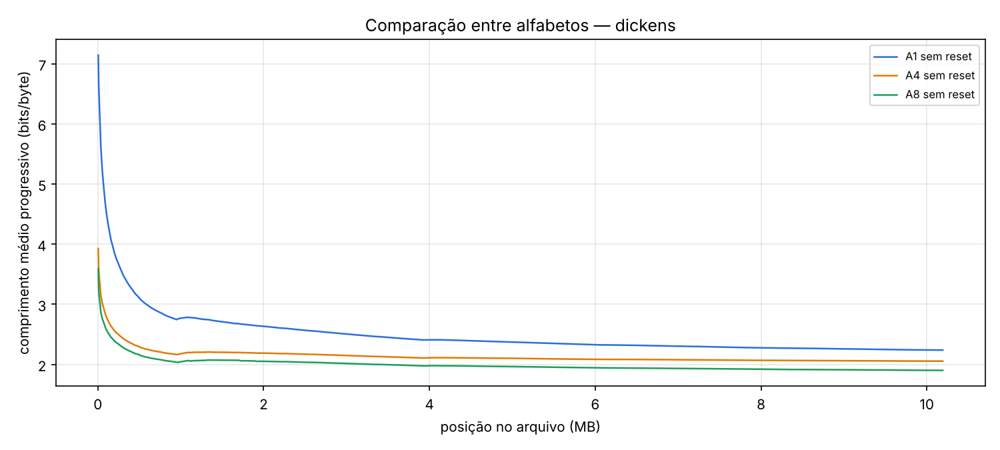
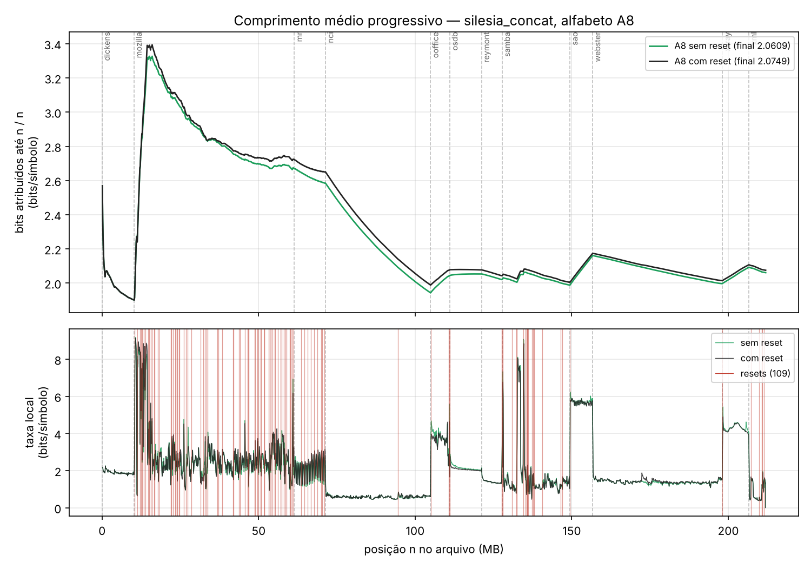
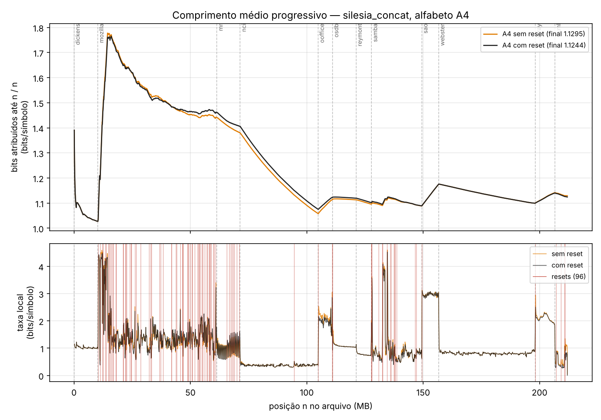

# Relatório — Compressor PPM-C com exclusão e reset (ITI 2026.2)

> **Rascunho em andamento.** Trechos entre **[colchetes]** dependem dos experimentos finais no Silesia completo.
> A versão editável deste relatório está no documento do Claude; este arquivo é uma cópia exportada em 24/11/2026.

**[Nomes dos integrantes da equipe]** · Introdução à Teoria da Informação — 2026.2 · Prof. Leonardo

## 1. Introdução

Este trabalho implementa em C++ um compressor sem perdas baseado no PPM-C com exclusão. Ele é avaliado em três resoluções de alfabeto (1, 4 e 8 bits) sobre o Corpus Silesia. O foco é a velocidade de aprendizado do modelo e sua reação quando a distribuição da fonte muda.

### 1.1 Contextualização

Todo compressor estatístico tem duas partes. O **modelo** estima a probabilidade de cada símbolo dado o que já foi visto. O **codificador** transforma essas probabilidades em bits. Um bom modelo atribui probabilidade alta ao que de fato acontece, e o codificador aritmético converte isso em um comprimento muito próximo do mínimo teórico.

Arquivos reais raramente são fontes estacionárias. O Corpus Silesia reúne 12 arquivos de natureza muito diferente: texto em inglês e em polonês, executáveis, bancos de dados, imagens médicas, XML. Quando o compressor passa de um arquivo para outro, as estatísticas aprendidas deixam de valer. Por isso o trabalho também implementa uma estratégia de reset do modelo, disparada pela piora da taxa local.

### 1.2 Fundamentação teórica

**Informação e entropia.** Um símbolo x com probabilidade p(x) carrega informação própria I(x). Para uma fonte sem memória, a entropia H é a média dessa informação, e o comprimento médio L de qualquer código unicamente decodificável satisfaz L ≥ H.

$$
I(x) = -\log_2 p(x) \qquad H(X) = -\sum_{x} p(x)\log_2 p(x) \qquad L \ge H(X)
$$

Com memória, o limite passa a ser a entropia condicional ao passado. É ela que um modelo de contexto tenta aproximar.

**Codificação aritmética.** A mensagem inteira é representada por um subintervalo de [0, 1). Cada símbolo reduz o intervalo proporcionalmente à sua probabilidade, e o número de bits necessário para identificar o intervalo final é aproximadamente a soma de −log2 p(xᵢ). Usamos a versão inteira de Witten, Neal e Cleary (1987), com renormalizações E1, E2 e E3.

**PPM (Prediction by Partial Matching).** Proposto por Cleary e Witten (1984), o PPM estima a probabilidade do próximo símbolo a partir dos k símbolos anteriores, o contexto de ordem k. A codificação começa na maior ordem disponível, Kmax. Se o símbolo nunca apareceu naquele contexto, emite-se um **escape** e tenta-se a ordem k−1. Na ordem −1, todos os símbolos são equiprováveis.

**Método C.** A variante C (Moffat, 1990) estima o escape pelo número de símbolos distintos d já vistos no contexto, dentre n ocorrências:

$$
P(s) = \frac{c(s)}{n + d} \qquad P(\text{escape}) = \frac{d}{n + d}
$$

**Exclusão.** Ao escapar de um contexto, sabe-se que o símbolo não é nenhum dos que lá aparecem. Esses símbolos são retirados da contagem nas ordens inferiores, e a probabilidade que ocupariam é redistribuída. Isso reduz o custo dos escapes sem perda de informação.

### 1.3 Objetivos

- Implementar compressor e descompressor PPM-C com exclusão para os alfabetos A1 = {0,1}, A4 = {0..15} e A8 = {0..255}.
- Implementar o monitoramento da taxa local em janelas de j símbolos, com reset do modelo quando a piora passa de p%, mantendo o descompressor sincronizado.
- Medir comprimento médio, tempos de compressão e descompressão em função de Kmax, j e p, e comparar com compressores de uso geral.
- Analisar a curva de comprimento médio progressivo no texto de Dickens e no Silesia completo.
- Demonstrar a integridade da descompressão com cmp.

## 2. Materiais e métodos

O compressor foi escrito em C++17, sem bibliotecas externas, e compilado com `g++ -O2`. Os scripts de experimentos e gráficos usam Python 3 com matplotlib. O código está em [github.com/kaiocesarb15/PPM-C](https://github.com/kaiocesarb15/PPM-C).

### 2.1 Organização do código

| Arquivo | Responsabilidade |
| --- | --- |
| `BitIO.hpp` | escrita e leitura de bits individuais |
| `SymbolStream.hpp` | conversão de bytes em símbolos de 1, 4 ou 8 bits e vice-versa |
| `ArithmeticCoder.hpp` | codificador e decodificador aritmético inteiro de 32 bits |
| `PPMModel.hpp` | modelo PPM-C: contextos, escape, exclusão, atualização |
| `RateMonitor.hpp` | janelas de j símbolos, regra de p% e decisão de reset |
| `Compressor.hpp` | cabeçalho do arquivo e laço principal de compressão e descompressão |
| `main.cpp` | linha de comando e medição de tempo |

### 2.2 Alfabetos

O mesmo arquivo é lido em três resoluções. Em A8 cada byte é um símbolo; em A4 cada byte gera dois símbolos (nibble alto, depois baixo); em A1 cada byte gera oito símbolos (bit mais significativo primeiro). Um arquivo de N bytes tem 8N/b símbolos no alfabeto de b bits.

Como o número de símbolos muda com o alfabeto, os resultados são dados em **bits/símbolo**, como pede o enunciado, e também em **bits/byte** do arquivo original. Só a segunda medida permite comparar os alfabetos entre si e com os compressores comerciais. Pelo mesmo motivo, Kmax = 32 em A1, Kmax = 8 em A4 e Kmax = 4 em A8 enxergam o mesmo passado: 4 bytes.

### 2.3 Modelo PPM-C

Cada ordem k tem uma tabela hash (`std::unordered_map`). A chave é o contexto empacotado num inteiro de 64 bits, que comporta todos os casos do trabalho: A1 com k = 32 ocupa 32 bits e A8 com k = 8 ocupa 64. Cada contexto guarda uma lista esparsa de pares (símbolo, contagem), o que evita alocar 256 contadores por contexto em A8.

Para cada símbolo, o modelo desce de min(Kmax, símbolos já vistos) até 0:

1. Calcula n e d apenas com os símbolos não excluídos do contexto. Contextos vazios são pulados sem custo.
2. Se o símbolo está no contexto, codifica-o com probabilidade c(s)/(n+d) e para.
3. Caso contrário, codifica o escape com probabilidade d/(n+d) e exclui os símbolos daquele contexto.
4. Se nenhuma ordem contém o símbolo, usa a ordem −1, uniforme sobre os símbolos ainda não excluídos.

Três detalhes completam o modelo:

- **Escape impossível.** Quando o contexto já contém todos os símbolos ainda possíveis, não se reserva probabilidade para o escape: P(s) = c(s)/n. Isso pesa sobretudo em A1, cujos contextos ficam completos com apenas dois símbolos.
- **Atualização.** Incrementa-se a contagem no contexto onde o símbolo foi achado e nos de ordem maior visitados antes dele (exclusão de atualização, como no PPMC original).
- **Rescale.** Quando a soma das contagens de um contexto passa de 65.000, todas são divididas por 2. Isso evita estouro dos contadores de 16 bits.

### 2.4 Reset por taxa local

A sequência é dividida em janelas adjacentes de j símbolos. Ao fechar cada janela, compara-se o número de bits gastos nela (B_atual) com o da janela anterior (B_ant). Como as duas têm o mesmo tamanho, comparar os bits equivale a comparar os comprimentos médios:

$$
\text{reset} \iff B_{\text{atual}} \cdot 100 > B_{\text{ant}} \cdot (100 + p)
$$

O reset apaga todas as tabelas. O histórico dos últimos símbolos é mantido, pois apenas identifica o contexto corrente. A janela seguinte a um reset não é comparada; ela vira a nova referência. Sem essa regra, o modelo ainda reaprendendo dispararia resets em cascata.

**Sincronia com o descompressor.** O custo de cada símbolo é medido pelo número de renormalizações do codificador aritmético. Cada renormalização corresponde a exatamente um bit de saída. O decodificador executa as mesmas renormalizações nos mesmos símbolos. Assim, os dois lados medem os mesmos valores inteiros e decidem o reset no mesmo ponto, sem nenhuma marca extra no arquivo.

### 2.5 Limite de memória

Modelos de ordem alta crescem sem limite: A8 com Kmax = 8 usou 557 MB só no dickens (10 MB). O programa estima a memória das tabelas (112 bytes por contexto mais 4 bytes por símbolo registrado) e reinicia o modelo quando a estimativa passa do limite configurado, 2 GB por padrão. A estimativa foi calibrada: com limite de 400 MB, o pico medido foi 386 MB. A decisão é determinística e, portanto, também sincronizada. Esses resets são contados à parte dos resets por taxa.

### 2.6 Formato do arquivo

Um cabeçalho de 32 bytes guarda o identificador, o alfabeto, Kmax, j, p, o limite de memória e o tamanho original. Com isso, o descompressor recebe apenas o arquivo comprimido. O cabeçalho está incluído em todas as taxas reportadas.

### 2.7 Dados e protocolo experimental

O Corpus Silesia (211.938.580 bytes, 12 arquivos) foi concatenado em ordem alfabética num único arquivo, para que as mudanças de fonte apareçam como transições entre arquivos. Para varreduras rápidas, foi usada também uma amostra de 24 MB: os primeiros 2 MB de cada arquivo, na mesma ordem. A análise de aprendizado usa o arquivo `dickens` (10.192.446 bytes, obras de Charles Dickens).

1. **Ordem.** Kmax de 0 a 32 em A1 e de 0 a 8 em A4 e A8, sem reset. Cada execução comprime, descomprime e compara byte a byte com o original.
2. **Reset.** Com o melhor Kmax de cada alfabeto, j ∈ {1.000, 2.000, 5.000, 10.000, 20.000, 50.000, 100.000} e p ∈ {5, 10, 20, 30, 40, 50}%.
3. **Comerciais.** gzip -9, bzip2 -9, xz -9, zstd -19, 7-Zip LZMA2 -mx9 e 7-Zip PPMd -mx9, nos mesmos arquivos.
4. **Curvas.** Comprimento médio progressivo, isto é, bits acumulados até a posição n divididos por n, amostrado em cerca de 2.000 pontos.

Tempos medidos com `std::chrono::steady_clock`, apenas a compressão ou descompressão em memória, sem leitura e gravação em disco. **[Preencher: configuração da máquina dos experimentos finais — processador, RAM, sistema.]** As varreduras preliminares rodaram numa máquina virtual Linux com 2 núcleos e 7 GB de RAM.

## 3. Resultados

No dickens, o melhor resultado foi A8 com Kmax = 6: **1,90 bits/byte**. A4 e A1 chegam perto quando enxergam o mesmo passado, mas nunca o superam. No Silesia completo, A8 fez 2,061 bits/byte, empatado com o bzip2 e atrás de xz e 7-Zip. O reset melhorou todos os alfabetos na amostra de 24 MB. Com os mesmos parâmetros, porém, piorou A8 no Silesia completo, porque disparou dentro de arquivos internamente heterogêneos.

### 3.1 Análise de ordem e desempenho

A tabela traz os resultados sem reset. Para A1, mostra-se Kmax de 4 em 4 e os três maiores valores; a varredura completa (0 a 32) está em `resultados/ordem_dickens.csv`. A coluna "Contexto" converte Kmax em bytes de passado (Kmax × b / 8), para comparar os alfabetos na mesma base. Na amostra do Silesia, mediu-se só a compressão.

| Alfabeto | Kmax | Contexto (bytes) | dickens bits/símb. | dickens bits/byte | t. comp. (s) | t. desc. (s) | amostra Silesia bits/byte |
| --- | --- | --- | --- | --- | --- | --- | --- |
| A8 | 0 | 0 | 4,5225 | 4,5225 | 2,0 | 2,0 | 5,3853 |
| A8 | 1 | 1 | 3,4897 | 3,4897 | 1,6 | 1,5 | 4,9304 |
| A8 | 2 | 2 | 2,8075 | 2,8075 | 1,5 | 1,4 | 3,6251 |
| A8 | 3 | 3 | 2,2669 | 2,2669 | 1,5 | 1,5 | 3,0674 |
| A8 | 4 | 4 | 1,9960 | 1,9960 | 2,3 | 2,1 | 2,8896 |
| A8 | 5 | 5 | 1,9068 | 1,9068 | 3,7 | 4,1 | 2,8420 |
| A8 | **6** | 6 | **1,9015** | **1,9015** | 6,2 | 6,8 | **2,8207** |
| A8 | 7 | 7 | 1,9341 | 1,9341 | 9,9 | 10,6 | 2,8396 |
| A8 | 8 | 8 | 1,9811 | 1,9811 | 13,8 | 15,0 | 2,8491 |
| A4 | 0 | 0 | 3,3820 | 6,7640 | 2,1 | 2,0 | 6,6574 |
| A4 | 1 | 0,5 | 2,4305 | 4,8610 | 2,0 | 2,0 | 5,9039 |
| A4 | 2 | 1 | 1,8896 | 3,7793 | 1,9 | 2,0 | 5,6389 |
| A4 | 3 | 1,5 | 1,6622 | 3,3244 | 2,1 | 2,0 | 5,1302 |
| A4 | 4 | 2 | 1,4451 | 2,8902 | 2,2 | 2,2 | 4,0313 |
| A4 | 5 | 2,5 | 1,3136 | 2,6271 | 2,2 | 2,2 | 3,5410 |
| A4 | 6 | 3 | 1,1668 | 2,3336 | 2,4 | 2,6 | 3,2479 |
| A4 | 7 | 3,5 | 1,0951 | 2,1901 | 3,2 | 3,9 | 3,1329 |
| A4 | **8** | 4 | **1,0277** | **2,0554** | 4,3 | 5,0 | **3,0254** |
| A1 | 0 | 0 | 0,9910 | 7,9284 | 4,0 | 4,0 | 7,4108 |
| A1 | 4 | 0,5 | 0,9322 | 7,4577 | 4,8 | 4,6 | 7,1208 |
| A1 | 8 | 1 | 0,6573 | 5,2583 | 4,6 | 4,7 | 6,4013 |
| A1 | 12 | 1,5 | 0,4719 | 3,7755 | 4,7 | 5,6 | 6,1494 |
| A1 | 16 | 2 | 0,3927 | 3,1419 | 5,9 | 6,8 | 4,9472 |
| A1 | 20 | 2,5 | 0,3424 | 2,7389 | 7,8 | 10,7 | 3,9830 |
| A1 | 24 | 3 | 0,3083 | 2,4662 | 10,3 | 16,5 | **3,2554** |
| A1 | 28 | 3,5 | 0,2907 | 2,3255 | 15,1 | 25,3 | 3,3657 |
| A1 | 30 | 3,75 | 0,2844 | 2,2753 | 19,1 | 32,4 | — |
| A1 | 31 | 3,875 | 0,2815 | 2,2521 | 20,9 | 32,4 | — |
| A1 | **32** | 4 | **0,2798** | **2,2386** | 22,5 | 35,8 | 3,5640 |

Tempos medidos na máquina virtual de 2 núcleos, com duas execuções simultâneas. Em negrito, o melhor Kmax de cada alfabeto.

Três observações:

- **Existe um Kmax ótimo em A8.** A taxa cai até Kmax = 6 e depois volta a subir. Contextos longos demais passam muito tempo com poucas ocorrências e pagam escapes em cascata. O tempo cresce sem parar: de 1,5 s (K = 2) para 13,8 s (K = 8).
- **Com o mesmo passado de 4 bytes**, A8 (K = 4) faz 2,00 bits/byte, A4 (K = 8) faz 2,06 e A1 (K = 32) faz 2,24. Quebrar o byte em pedaços custa um pouco: o modelo precisa aprender várias decisões encadeadas para prever um único caractere.
- **A1 em dados binários esbarra na memória.** Na amostra do Silesia, K = 24 fica melhor que K = 32 (3,26 contra 3,56 bits/byte). Com K = 32, o modelo atingiu o limite de 2 GB 23 vezes e foi reiniciado; com K = 24, só 3. O custo por símbolo também explode: comprimir a amostra levou 130 s com K = 24 e 610 s com K = 32.



Figura 1 — Taxa (bits/byte) e tempo de compressão em função do contexto máximo em bytes (Kmax × b / 8), dickens.

**[Acrescentar a varredura de Kmax no Silesia completo.]**

### 3.2 Estratégia de reset

Na amostra do Silesia (2 MB de cada um dos 12 arquivos), o reset melhorou a taxa em todos os alfabetos. O ganho foi de 1,4% em A8 a 3,5% em A4. Em todos, os melhores parâmetros ficaram no extremo da grade: janelas grandes (j de 50.000 a 100.000) e tolerância alta (p = 50%).

| Alfabeto | Kmax | Sem reset (bits/byte) | Com reset (bits/byte) | Melhor j | Melhor p | Resets | Ganho |
| --- | --- | --- | --- | --- | --- | --- | --- |
| A8 | 6 | 2,8207 | 2,7818 | 50.000 | 50% | 9 | 1,4% |
| A4 | 8 | 3,0254 | 2,9205 | 100.000 | 50% | 9 | 3,5% |
| A1 | 24 | 3,2554 | 3,1876 | 100.000 | 50% | 20 | 2,1% |

Grade testada: j ∈ {1.000, 5.000, 10.000, 50.000, 100.000} e p ∈ {5, 10, 20, 30, 50}% para A8 e A4. Em A1, o alfabeto mais lento, testou-se j ∈ {10.000, 50.000, 100.000} e p ∈ {10, 30, 50}%. O CSV completo está em `resultados/reset_silesia_amostra.csv`.

O número de resets nas melhores configurações (9) é próximo do número de transições entre arquivos na amostra (11). Isso indica que o critério detecta as mudanças de fonte.

Com janelas pequenas, o critério vira ruído e o reset passa a atrapalhar. Em A8, j = 1.000 com p = 5% disparou 3.852 resets e piorou a taxa para 3,66 bits/byte, 30% acima do modelo sem reset. Em A4, a mesma configuração chegou a 9.819 resets. Uma janela de 1.000 símbolos corresponde a 1.000 bytes em A8, mas a só 125 bytes em A1, onde a flutuação natural da taxa já supera p.



Figura 2 — Bits/símbolo em função de j e p na amostra do Silesia, um painel por alfabeto, com a taxa sem reset no título.

**[Acrescentar a grade de reset no Silesia completo.]**

### 3.3 Comparação com compressores comerciais

No texto de Dickens, o PPM-C A8 supera todos os compressores de uso geral testados e só perde para o PPMd do 7-Zip. Na amostra do Silesia, com dados binários, perde para bzip2, xz e 7-Zip.

| Compressor | dickens (bits/byte) | dickens t. comp. (s) | amostra Silesia (bits/byte) | amostra t. comp. (s) |
| --- | --- | --- | --- | --- |
| 7-Zip PPMd -mx9 | 1,790 | 2,9 | 2,535 | 4,7 |
| **PPM-C A8, Kmax = 6** | **1,902** | 6,2 | 2,821 (2,782 com reset) | 42,3 |
| PPM-C A4, Kmax = 8 | 2,055 | 4,3 | 3,025 (2,921 com reset) | 49,9 |
| bzip2 -9 | 2,197 | 0,9 | 2,669 | 2,1 |
| xz -9 (LZMA2) | 2,222 | 8,6 | 2,663 | 9,5 |
| 7-Zip LZMA2 -mx9 | 2,222 | 5,1 | 2,661 | 4,7 |
| zstd -19 | 2,237 | 7,1 | 2,848 | 8,6 |
| PPM-C A1, Kmax = 32 / 24 | 2,239 | 22,5 | 3,255 (3,188 com reset) | 130,2 |
| gzip -9 | 3,023 | 1,1 | 3,268 | 2,5 |

No dickens, a linha de PPM-C A1 usa Kmax = 32; na amostra, Kmax = 24, o melhor de cada arquivo. Todos os compressores comerciais foram verificados com `cmp`. No Silesia completo, o PPM-C A8 empata com o bzip2 (2,061 bits/byte) e fica atrás de zstd, xz e 7-Zip.

| Compressor (Silesia completo, 212 MB) | bits/byte | t. comp. (s) | t. desc. (s) |
| --- | --- | --- | --- |
| 7-Zip PPMd -mx9 | 1,814 | 38,6 | 41,1 |
| 7-Zip LZMA2 -mx9 | 1,839 | 69,5 | 3,4 |
| xz -9 (LZMA2) | 1,840 | 120,5 | 3,4 |
| zstd -19 | 2,001 | 116,6 | 0,3 |
| bzip2 -9 | 2,061 | 18,8 | 7,9 |
| **PPM-C A8, Kmax = 6, sem reset** | **2,061** | **[preencher]** | **[preencher]** |
| PPM-C A4, Kmax = 8, com reset | 2,249 | [preencher] | [preencher] |
| gzip -9 | 2,554 | 22,9 | 1,6 |

O PPMd é uma evolução do PPM com estimação adaptativa do escape (SEE) e herança de contagens entre ordens. A diferença de 0,11 bits/byte no dickens mostra o quanto o método C deixa na mesa. Nos dados binários, os compressores LZ e BWT exploram repetições longas e estruturas que um contexto fixo de 6 bytes não alcança. Em tempo, o PPM-C A8 é mais rápido que o xz no dickens (6,2 contra 8,6 s), mas na amostra binária é 4 vezes mais lento que o xz e 20 vezes mais lento que o bzip2.

### 3.4 Aprendizado e estacionariedade no dickens

No texto de Dickens, A4 e A8 chegam a 10% do valor final em menos de 1 MB. A1 precisa de 3,4 MB. Depois disso, as três curvas caem devagar até o fim do arquivo: o modelo continua aprendendo contextos mais raros.

| Posição no arquivo | A1, K = 32 (bits/byte) | A4, K = 8 (bits/byte) | A8, K = 6 (bits/byte) |
| --- | --- | --- | --- |
| 100 KB | 4,53 | 2,79 | 2,58 |
| 500 KB | 3,11 | 2,29 | 2,16 |
| 1 MB | 2,77 | 2,18 | 2,04 |
| 2 MB | 2,64 | 2,19 | 2,05 |
| 5 MB | 2,37 | 2,10 | 1,96 |
| 10 MB (final) | 2,24 | 2,06 | 1,90 |

| Critério de estabilização | A1 | A4 | A8 |
| --- | --- | --- | --- |
| dentro de ±10% do valor final | 3,38 MB | 0,57 MB | 0,70 MB |
| dentro de ±5% do valor final | 5,46 MB | 2,81 MB | 3,48 MB |
| dentro de ±1% do valor final | 8,87 MB | 7,25 MB | 8,09 MB |

O ponto de estabilização é a primeira posição a partir da qual a média progressiva nunca mais se afasta do valor final mais que a tolerância. Com ±10%, o "joelho" da curva fica em torno de 0,6 a 0,7 MB para A4 e A8, e de 3,4 MB para A1.

A1 aprende muito mais devagar. Com 100 KB lidos, A8 já faz 2,58 bits/byte e A1 ainda faz 4,53. Prever um caractere em A1 exige oito decisões binárias, cada uma com seu próprio contexto, e cada contexto precisa ser visto várias vezes antes de ficar confiável. A4 começa pior que A8 (2,79 contra 2,58 em 100 KB), mas os contextos de A4 são menos numerosos e se preenchem mais rápido. Por isso A4 entra na faixa de ±10% antes de A8.

Perto de 1 MB, as três curvas têm uma pequena subida. É o único ponto visível de não-estacionariedade dentro do dickens, provavelmente a passagem para outra obra com vocabulário diferente.



Figura 3 — Comprimento médio progressivo no dickens, em bits/byte, para A1 (K = 32), A4 (K = 8) e A8 (K = 6). Os gráficos individuais em bits/símbolo, com os pontos de estabilização marcados, estão em `resultados/grafico_curva_dickens_a{1,4,8}.png`.

### 3.5 Aprendizado e estacionariedade no Silesia

No Silesia completo (212 MB, 12 arquivos concatenados), a taxa local salta a cada troca de arquivo. A média progressiva nunca estabiliza: ela sobe nos arquivos difíceis e desce nos fáceis. Sem reset, A8 com Kmax = 6 fecha em **2,061 bits/byte** e A4 com Kmax = 8 em **2,259**.

Os parâmetros de reset escolhidos na amostra **não se transferiram** para o Silesia completo:

| Alfabeto | Kmax | j | p | Sem reset (bits/byte) | Com reset (bits/byte) | Resets por taxa | Resets por memória (sem / com reset) |
| --- | --- | --- | --- | --- | --- | --- | --- |
| A8 | 6 | 50.000 | 50% | 2,0609 | 2,0749 (+0,7%) | 109 | 6 / 1 |
| A4 | 8 | 100.000 | 50% | 2,2590 | 2,2489 (−0,4%) | 96 | 5 / 1 |

**[Atualizar com a melhor configuração da grade de reset no Silesia completo, e acrescentar A1.]**

A tabela abaixo decompõe a taxa por arquivo. Ela foi calculada pela diferença de bits acumulados entre as fronteiras de cada arquivo na curva progressiva.

| Arquivo | Tipo | Tamanho (MB) | A8 sem reset | A8 com reset | A4 sem reset | A4 com reset | Resets A8 |
| --- | --- | --- | --- | --- | --- | --- | --- |
| dickens | texto em inglês | 10,2 | 1,895 | 1,895 | 2,048 | 2,048 | 0 |
| mozilla | executáveis e bibliotecas (tar) | 51,2 | 2,822 | 2,884 | 3,045 | 3,095 | 70 |
| mr | imagem de ressonância magnética | 10,0 | 2,047 | 2,199 | 2,005 | 2,122 | 9 |
| nci | base de estruturas químicas | 33,6 | 0,578 | 0,580 | 0,744 | 0,740 | 1 |
| ooffice | DLL do OpenOffice | 6,2 | 3,774 | **3,590** | 4,173 | **3,900** | 3 |
| osdb | banco de dados de teste | 10,1 | 2,151 | **2,074** | 2,188 | **2,157** | 1 |
| reymont | texto em polonês (PDF) | 6,6 | 1,465 | 1,459 | 1,604 | 1,602 | 1 |
| samba | código-fonte (tar) | 21,6 | 1,781 | **1,763** | 2,076 | **2,009** | 17 |
| sao | catálogo de estrelas | 7,3 | 5,722 | **5,670** | 5,939 | 5,929 | 1 |
| webster | dicionário | 41,5 | 1,386 | 1,421 | 1,634 | 1,633 | 1 |
| x-ray | radiografia | 8,5 | 4,319 | **4,254** | 4,240 | **4,168** | 1 |
| xml | arquivos XML | 5,3 | 0,830 | 0,834 | 1,308 | **1,016** | 5 |

Valores em bits/byte. Em negrito, as melhoras de pelo menos 0,015 bits/byte.

**Onde a compressão sofre.** As maiores perdas ocorrem nas entradas em `mozilla` (de ~1,9 para ~8 bits/símbolo local), `ooffice`, `sao` e `x-ray`. Nesses pontos, o modelo traz contextos e contagens de um arquivo de natureza muito diferente. Os símbolos novos custam escapes em todas as ordens, e os antigos carregam probabilidades erradas.

**Onde o reset ajuda.** Cada troca de arquivo real (ooffice, osdb, samba, sao, x-ray, xml) disparou um reset no primeiro MB do novo arquivo. Esses resets recuperaram de 0,02 a 0,18 bits/byte. O maior ganho foi no xml em A4, de 1,31 para 1,02 bits/byte: o modelo herdado do x-ray era especialmente ruim para texto estruturado.

**Onde o reset atrapalha.** Dos 109 resets em A8, 70 ocorreram dentro do `mozilla` e 9 dentro do `mr`. Esses arquivos são internamente heterogêneos (um tar de binários variados e uma imagem com fatias de estatística diferente), e a taxa local oscila mais de 50% entre janelas de 50.000 bytes. Cada falso positivo descarta um modelo que ainda era útil, e o custo de reaprender superou o ganho nos outros arquivos.

**O limite de memória age como reset.** Sem reset por taxa, A8 com Kmax = 6 atingiu o limite de 2 GB seis vezes, em mozilla, ooffice, samba, sao e x-ray. Ou seja, o modelo "sem reset" também foi reiniciado de tempos em tempos, o que reduz a vantagem relativa da estratégia por taxa.



Figura 4 — Silesia completo, A8 com Kmax = 6. Em cima, comprimento médio progressivo com e sem reset (j = 50.000, p = 50%). Embaixo, taxa local entre pontos consecutivos da curva. Linhas tracejadas cinza marcam as fronteiras entre arquivos; linhas vermelhas, os resets.



Figura 5 — Silesia completo, A4 com Kmax = 8, com e sem reset (j = 100.000, p = 50%).

**[Acrescentar a curva de A1 no Silesia completo.]**

### 3.6 Integridade

Todas as execuções com descompressão foram verificadas byte a byte e reproduziram o original. Isso inclui as 51 do dickens e os 112 testes do `scripts/verificar.sh`: arquivos vazio, de 1 byte, só zeros, aleatório, repetitivo, misto e código-fonte, em 16 configurações de alfabeto, Kmax, reset e limite de memória. Os resets também ficaram sincronizados: num caso extremo (A1, j = 1.000, p = 5%), compressor e descompressor registraram os mesmos 22.722 resets e o arquivo foi recuperado intacto.

```
$ ./ppmc c -a 8 -k 6 dados/dickens dickens.ppmc
bytes_entrada: 10192446
bytes_saida: 2422615
bits_por_byte: 1.901498
$ ./ppmc d dickens.ppmc dickens.out
bytes_saida: 10192446
tempo_s: 6.455
$ cmp dados/dickens dickens.out && echo IDENTICOS
IDENTICOS
$ sha256sum dados/dickens dickens.out
b24c37886142e11d0ee687db6ab06f936207aa7f2ea1fd1d9a36763c7a507e6a  dados/dickens
b24c37886142e11d0ee687db6ab06f936207aa7f2ea1fd1d9a36763c7a507e6a  dickens.out
```

## 4. Discussão

### 4.1 Rapidez de aprendizado e cardinalidade do alfabeto

O alfabeto maior aprende mais rápido por byte lido. No dickens, A8 chega a 2,58 bits/byte nos primeiros 100 KB, A4 a 2,79 e A1 a 4,53. A1 precisa de cerca de 3,4 MB para ficar a 10% do seu valor final; A4 e A8, de menos de 1 MB.

A explicação está em quantas decisões o modelo precisa aprender para prever um caractere. Em A8 é uma decisão, num contexto que já inclui os bytes anteriores inteiros. Em A1 são oito decisões binárias em sequência, e as primeiras ainda não sabem nada sobre o byte atual. Cada uma dessas oito "posições de bit" tem seus próprios contextos, que precisam ser vistos várias vezes antes de darem boas previsões.

No fim, com o mesmo passado (4 bytes), os três alfabetos ficam próximos no texto: 2,00 (A8), 2,06 (A4) e 2,24 (A1) bits/byte. A diferença restante vem do aprendizado mais lento e do custo dos escapes encadeados em A1.

### 4.2 Impacto dos parâmetros

**Kmax.** Em A8 existe um ótimo claro (K = 6 no texto e na amostra). Abaixo dele, o modelo não enxerga dependências suficientes. Acima, os contextos ficam raros demais e a maioria dos símbolos paga escapes em cascata até uma ordem com estatística. Em A4 e A1, a taxa ainda caía no maior Kmax permitido no texto. Em dados binários, A1 piorou acima de K = 24 por causa do limite de memória. O tempo e a memória crescem com Kmax em todos os casos, e muito mais rápido em dados binários.

**j e p.** A janela pequena torna o critério ruidoso. Com j = 1.000 e p = 5%, A8 fez milhares de resets e piorou 30%. Janelas grandes e tolerância alta funcionaram melhor em todos os testes. Os melhores valores ficaram no extremo da faixa pedida (j = 100.000, p = 50%), o que sugere que o ótimo pode estar fora dela. O valor de j precisa ser pensado na unidade do alfabeto: 100.000 símbolos são 100 KB em A8, mas só 12,5 KB em A1.

### 4.3 Estratégias de tratamento de mudanças na distribuição

O reset por taxa local acerta as transições reais entre arquivos: em A8, as entradas em mozilla, ooffice, osdb, samba, sao, x-ray e xml geraram um reset no primeiro MB do novo arquivo, com ganhos de até 0,29 bits/byte no arquivo seguinte. O problema são os falsos positivos em arquivos internamente heterogêneos, como `mozilla` e `mr`. Neles, a taxa local oscila naturalmente mais que p entre duas janelas, e o critério não distingue essa oscilação de uma mudança de fonte.

O reset total também é uma resposta drástica: joga fora até as estatísticas de ordem baixa, que costumam continuar úteis. O rescale de contagens (divisão por 2) e o limite de memória já dão ao modelo alguma capacidade de esquecer. Melhorias possíveis, não implementadas:

- exigir que a piora se mantenha por duas ou mais janelas seguidas antes de resetar;
- comparar a janela atual com a média de várias janelas anteriores, e não só com a última;
- exigir também uma piora mínima absoluta, em bits/símbolo, além da relativa;
- em vez de apagar tudo, dividir todas as contagens por um fator grande (reset "suave"), ou apagar só as ordens altas.

### 4.4 Problemas e dificuldades

- **Sincronia do reset.** Medir o custo em ponto flutuante (−log2 p) no compressor e no descompressor poderia gerar decisões diferentes em máquinas distintas. A solução foi contar as renormalizações do codificador aritmético, um valor inteiro e idêntico nos dois lados.
- **Memória.** A8 com Kmax = 8 usou 557 MB no dickens. No Silesia completo, sem limite, seriam dezenas de GB. O limite determinístico resolveu, mas interfere nos resultados: o modelo "sem reset" também foi reiniciado algumas vezes.
- **Tempo.** A1 com Kmax alto em dados binários custou cerca de 2,5 µs por símbolo, quase sempre em inserções de contextos novos na tabela hash. Comprimir a amostra de 24 MB com K = 32 levou 10 minutos. Por isso, a grade de A1 foi reduzida.
- **Escape em A1.** No PPM-C clássico, um contexto binário que já viu os dois símbolos continua reservando probabilidade para o escape, que nunca pode ocorrer. Detectar esse caso e não reservar a probabilidade foi importante para A1.

## 5. Conclusão

O compressor PPM-C com exclusão foi implementado para os três alfabetos e recupera os arquivos byte a byte em todos os testes. No texto, A8 com Kmax = 6 atinge 1,90 bits/byte, melhor que bzip2, xz e zstd. No Silesia completo, empata com o bzip2 em 2,06 bits/byte.

A cardinalidade do alfabeto determina a velocidade de aprendizado. A8 e A4 ficam a 10% do valor final em menos de 1 MB de texto; A1 precisa de mais de três vezes isso e termina 12% pior com o mesmo passado de 4 bytes.

O reset por taxa local, sincronizado sem nenhum bit extra pela contagem de renormalizações, detecta as trocas de arquivo e recupera a taxa logo depois delas. O desempenho final, porém, depende muito de j e p. Parâmetros bons numa amostra disparam falsos positivos dentro de arquivos heterogêneos no corpus completo. Os melhores resultados vieram de janelas grandes e tolerância alta. Um critério mais robusto (piora persistente, ou reset parcial) é o próximo passo natural.

## Referências

- CLEARY, J. G.; WITTEN, I. H. Data compression using adaptive coding and partial string matching. *IEEE Transactions on Communications*, v. 32, n. 4, p. 396–402, 1984.
- MOFFAT, A. Implementing the PPM data compression scheme. *IEEE Transactions on Communications*, v. 38, n. 11, p. 1917–1921, 1990.
- WITTEN, I. H.; NEAL, R. M.; CLEARY, J. G. Arithmetic coding for data compression. *Communications of the ACM*, v. 30, n. 6, p. 520–540, 1987.
- DEOROWICZ, S. Silesia compression corpus. Disponível em: [sun.aei.polsl.pl/~sdeor/index.php?page=silesia](https://sun.aei.polsl.pl/~sdeor/index.php?page=silesia).
- SAYOOD, K. *Introduction to Data Compression*. 5. ed. Morgan Kaufmann, 2017.
- Código-fonte do trabalho: [github.com/kaiocesarb15/PPM-C](https://github.com/kaiocesarb15/PPM-C).
